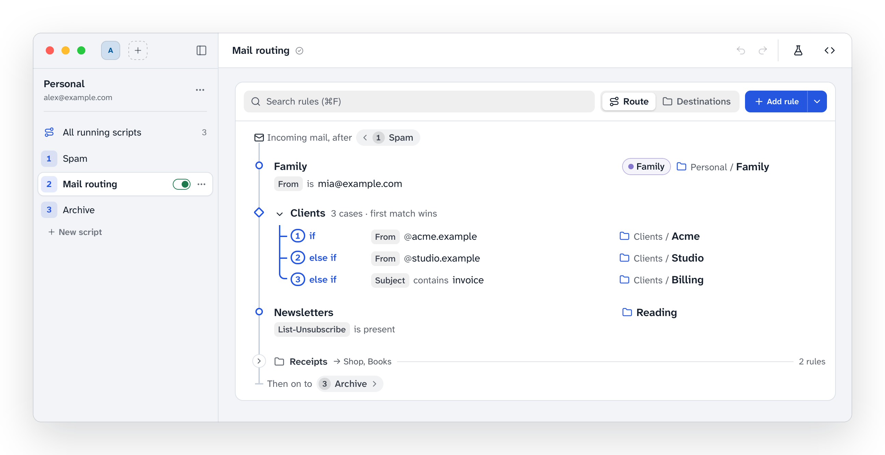

# sieve-gui

A lightweight, cross-platform desktop editor for **server-side Sieve mail filters**. It talks to your mail server via **ManageSieve** (RFC 5804), so filters keep running even when no mail client is open. Built with Tauri and Svelte.

<picture>
  <source media="(prefers-color-scheme: dark)" srcset="docs/screenshot-dark.png">
  
</picture>

> **Status:** early development. Visual rule editing, script management, trying rules with a sample message and saving via ManageSieve work. See [`docs/concept.md`](docs/concept.md).

## What it does

- **Rules as a route.** A script reads top to bottom like the way a message takes: one stop per rule, numbered cases ("if", "else if", "otherwise", first match applies), nested checks one rail deeper, condition groups as brackets. Runs of rules filing into the same folder form foldable sections.
- **Destinations.** The other way round: every folder and label the scripts send mail to, with the rules that do it. Add a rule for a folder right there.
- **All running scripts.** Several active scripts run in order through a generated root script. See their route and destinations together, or one script alone.
- **Try it.** Enter or paste a message and see its way through every running script: which case applies, where it ends up, and what an unsaved edit would change.
- **Edit one case at a time.** The inspector shows a case with its context; folders come from the server (searchable), labels as chips with the names and colors you give them, or take over from Synology MailPlus.
- **Safe saving.** The server checks the script (`CHECKSCRIPT`) before it is saved, conflicts are detected, and the diff can show only the changes in what the script does: comments and layout aside.
- **Several accounts.** One account at a time in the sidebar, switched by its icon (initials, an emoji or a picture). Code sieve-gui can't show as rules stays as written. Roundcube-written scripts and Synology MailPlus scripts are read as they are.
- **Take over filters from other systems.** Systems that write Sieve from their own filter settings rewrite their scripts on every save, so they can't run next to sieve-gui. sieve-gui finds their filters and turns them into rules, then manages them alone. Synology MailPlus is the first such provider: its web UI filters and block and allow lists become rules, and if MailPlus makes its own script active again, sieve-gui takes over again when it connects.

---

## Install

### Linux

```sh
curl -fsSL https://raw.githubusercontent.com/lukas-runge/sieve-gui/main/scripts/install.sh | sh
```

The script takes the latest [release](https://github.com/lukas-runge/sieve-gui/releases/latest) for your system: the `.deb` with apt (Debian 12+, Ubuntu 22.04+, Mint, …), the `.rpm` with dnf or zypper (Fedora, openSUSE, …), otherwise the AppImage in `~/.local/bin` with a menu entry (AppImages need FUSE 2: `libfuse2` / `fuse2`). `sh -s -- --appimage` takes the AppImage everywhere, without root.

**Updates:** when a new version is out, sieve-gui says so in the sidebar. "Update" closes the app, installs the new version (asking for the admin password for `.deb` and `.rpm`) and starts it again. Running the script again does the same.

### macOS and Windows

Download the installer from the [latest release](https://github.com/lukas-runge/sieve-gui/releases/latest).

---

## Stack

| Layer | Technology |
|---|---|
| Desktop shell | [Tauri](https://tauri.app) |
| UI framework | [SvelteKit](https://kit.svelte.dev) + [Svelte](https://svelte.dev) |
| Styling | [Tailwind CSS](https://tailwindcss.com) + [daisyUI](https://daisyui.com) |
| Language (frontend) | TypeScript |
| Language (backend) | Rust |
| TS bindings | [`tauri-ts-generator`](https://github.com/lukas-runge/tauri-codegen) |
| Package manager | pnpm |

---

## Prerequisites

| Tool | Install |
|---|---|
| Node.js | [nodejs.org](https://nodejs.org) |
| pnpm | `npm i -g pnpm` |
| Rust | [rustup.rs](https://rustup.rs) |
| Tauri CLI v2 | bundled via `pnpm tauri` |

**Linux only** — install WebKit and related system libraries:

```bash
sudo apt-get install -y \
  libwebkit2gtk-4.1-dev \
  libdbus-1-dev \
  libappindicator3-dev \
  librsvg2-dev \
  patchelf
```

---

## Getting started

```bash
# 1. Clone
git clone https://github.com/lukas-runge/sieve-gui.git
cd sieve-gui

# 2. Install frontend dependencies (also installs tauri-ts-generator and generates TS bindings)
pnpm install

# 3. Start in development mode (hot-reload frontend + Rust backend)
pnpm tauri dev
```

The app window opens automatically. The Vite dev server runs on `http://localhost:1420`.

On macOS, `cargo run` and `pnpm tauri dev` sign the app with your "Apple Development" identity before starting it (`scripts/dev-runner.sh`; override with `SIEVE_GUI_SIGNING_IDENTITY`). The keychain then recognizes rebuilds as the same app, so after "Always Allow" once it stops asking for the login keychain password on every start. Without such an identity the app runs unsigned and the keychain asks after every rebuild.

---

## Building

```bash
# Production build for the current platform
pnpm tauri build
```

Artifacts land in `target/release/bundle/` (Cargo workspace target directory).

---

## Project structure

```
sieve-gui/
├── crates/
│   ├── sieve-core/             # Sieve lexer, parser, AST, printer, rule model (import/export), content comparison
│   │   └── tests/fixtures/roundcube/   # real scripts generated by Roundcube (see README there)
│   ├── managesieve/            # async ManageSieve (RFC 5804) client
│   └── mailstore/              # read-only IMAP access (folder list)
├── src-tauri/src/              # Tauri commands: accounts + keychain, sessions, rules, folders
├── src/                        # SvelteKit frontend
│   ├── lib/components/         # sidebar, inspector, editors, dialogs
│   ├── lib/components/route/   # the route and destinations views
│   ├── lib/rules/              # rule model ⇄ editor fields, route summaries, search, the test evaluator
│   ├── lib/dev/                # browser preview mode (fake backend, dev only)
│   └── generated/tauri/        # auto-generated TS bindings (do not edit)
├── scripts/fetch-pigeonhole.sh # downloads the Pigeonhole test suite for parser tests
├── docs/concept.md             # product and architecture concept
└── docs/screenshot*.png        # the README screenshot, light and dark (preview with `?mac&hero`)
```

---

## Tests

```bash
cargo test --workspace          # unit, round-trip, fuzz and Roundcube compatibility tests
pnpm check                      # svelte-check
pnpm test                       # frontend unit tests (node --test)

# Parser against every script of the Dovecot Pigeonhole test suite
scripts/fetch-pigeonhole.sh
PIGEONHOLE_DIR=.cache/pigeonhole cargo test -p sieve-core --test pigeonhole -- --ignored

# ManageSieve and IMAP clients against a real Dovecot (Docker)
crates/managesieve/tests/dovecot/gen-certs.sh
docker compose -f crates/managesieve/tests/dovecot/compose.yaml up -d --build
MANAGESIEVE_TEST_ADDR=localhost:14190 MANAGESIEVE_TEST_TLS_ADDR=localhost:14191 \
  cargo test -p managesieve --test dovecot
MAILSTORE_TEST_ADDR=localhost:14143 MAILSTORE_TEST_TLS_ADDR=localhost:14993 \
  cargo test -p mailstore --test dovecot
```

The longer fuzz runs take `SIEVE_FUZZ_ITERS` and `SIEVE_FUZZ_SEED`.

### Browser preview

`pnpm dev` without Tauri opens the UI in a normal browser at `http://localhost:1420` with a fake backend (`src/lib/dev/mock.ts`). Rule data comes from fixtures sieve-core produced: from the Roundcube and MailPlus test scripts (`fixtures.json`, `fixtures-mailplus.json`) and from made-up English showcase scripts (`fixtures-showcase.json`). `?hero` switches to the calm account of the screenshot above (`fixtures-hero.json`). Add `?mac` to the URL to see the macOS title bar (the window controls are drawn in). Script generation needs the desktop app.

---

## How it works

Tauri exposes Rust functions as IPC commands. `tauri-ts-generator` scans the repository (so that types from `crates/*` used by commands are found) and generates typed TypeScript wrappers into `src/generated/tauri/`, importable via the `#tauri/*` alias:

```ts
import { importRules } from "#tauri/commands";
import type { RuleSet } from "#tauri/types";
```

Bindings are regenerated automatically before `dev`, `build` and `check`.

---

## Releases

Pushing a `v*` tag builds draft releases for:

| Platform | Architecture |
|---|---|
| Linux | x86-64, ARM64 |
| Windows | x86-64, ARM64 |
| macOS | x86-64 (Intel), ARM64 (Apple Silicon) |

> **Note:** Builds are not code-signed. macOS builds are ad-hoc signed so Apple Silicon runs them, but Gatekeeper will still warn on first launch; Windows shows a SmartScreen prompt.

---

## Contributing

Found a bug? Have an idea? 😃 Just open an issue or send a PR — all help is genuinely appreciated. 🙏
